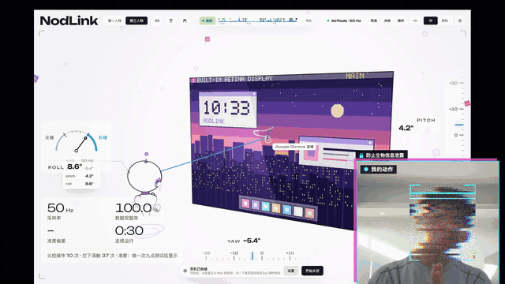

# NodLink

**一副 AirPods，就是一只入耳式鼠标。**转头移动光标，歪头点击，开口说指令。不用摄像头，也不用额外佩戴任何东西。

[在线体验（用鼠标模拟头部）](https://gintmr.github.io/NodLink/) · [在 Mac 上安装](#安装)

> 下面的画面都是真人戴着 AirPods、手不碰键鼠录的。右下角是本人的动作（打了马赛克）。点图片可以放大。

<p align="center"></p>
<p align="center"><b>控制台</b> · 头转到哪，光标就到哪</p>

<table>
  <tr>
    <td width="50%"><br><b>附身奶蛙</b> · 你点头，它就笑；你转头，它出招</td>
    <td width="50%"><br><b>关弹窗</b> · 头指到按钮，说“点击”</td>
  </tr>
  <tr>
    <td><br><b>刷短视频</b> · 歪头下一条，说“双击”点赞</td>
    <td><br><b>回消息</b> · 歪头按住说话，回正上屏</td>
  </tr>
  <tr>
    <td><br><b>点外卖</b> · 选菜、写备注、下单</td>
    <td><br><b>刷抖音</b> · 真实网页版，歪头换下一条（他人作品已模糊）</td>
  </tr>
</table>

## 安装

需要：macOS 14 以上的 Mac，支持头部追踪的 AirPods（第 3 代及以后、Pro、Max），Node.js 18 以上。

```bash
xcode-select --install                          # Xcode 命令行工具，装过会提示已安装
git clone https://github.com/gintmr/NodLink.git
cd NodLink/web && npm install && npm start      # 控制台：http://localhost:8787
```

另开一个终端，启动耳机桥：

```bash
cd NodLink/mac/NodLinkBridge && ./run.sh
```

戴上 AirPods，打开 http://localhost:8787 ，按顶部引导走：连接耳机 → 定正前方 → 开始头控。第一次会请求运动与健身、辅助功能、麦克风、语音识别权限，都只在本机处理。随时按 **Esc** 交还鼠标。

## 怎么用

| 动作 | 效果 |
|---|---|
| 转头 | 移动光标 |
| 左歪头再回正 / 右歪头再回正 | 单击 / 右键 |
| 左歪头停住 | 按住拖拽 |
| 说“点击”“双击”“上滑”…… | 语音指令，中英文都行 |

更多说明：[控制台](web/README.md) · [耳机桥](mac/NodLinkBridge/README.md)

## 协议

[MIT](LICENSE)。第三方 3D 模型为 CC0，见 [`web/public/models/README.md`](web/public/models/README.md)。AirPods、Mac 是 Apple Inc. 的商标，本项目与 Apple 无关。
