<p align="right"><b>English</b> · <a href="README.zh-CN.md">简体中文</a></p>

<p align="center">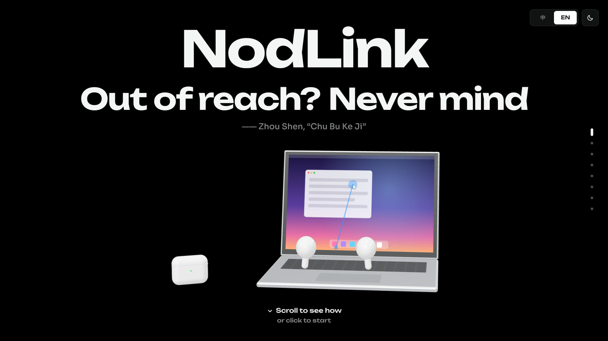</p>

<h3 align="center">Your AirPods are already a mouse.</h3>

<p align="center">Turn your head to point. Tilt to click. Speak to command.<br>No camera, nothing extra to wear.</p>

<p align="center">
  <a href="https://gintmr.github.io/NodLink/"><b>Try it online</b></a> (mouse simulates your head)
  &nbsp;·&nbsp;
  <a href="#install"><b>Install on Mac</b></a>
</p>

## Screenshots

<table>
  <tr>
    <td width="50%">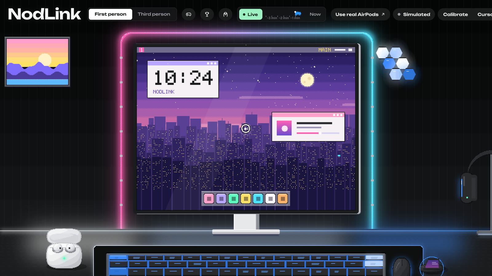<br><b>First person</b> · your desk, your cursor</td>
    <td width="50%">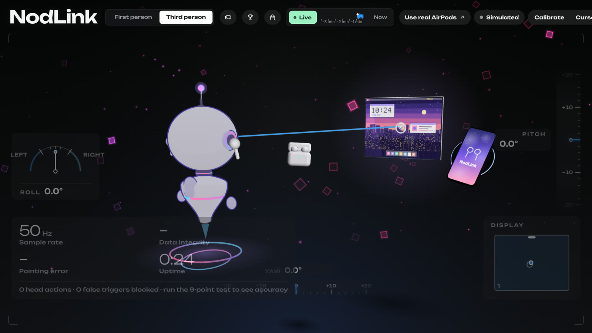<br><b>Third person</b> · see where your head points</td>
  </tr>
  <tr>
    <td>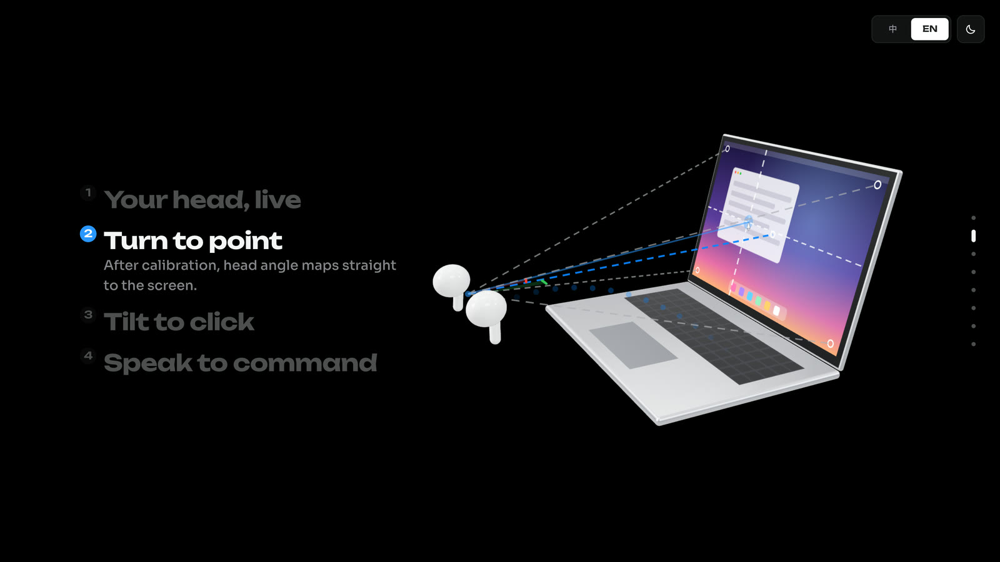<br><b>Turn to point</b> · head angle maps straight to the screen</td>
    <td>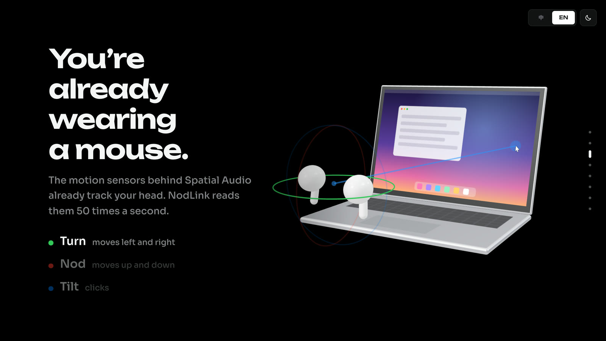<br><b>Built-in sensors</b> · read 50 times a second</td>
  </tr>
  <tr>
    <td>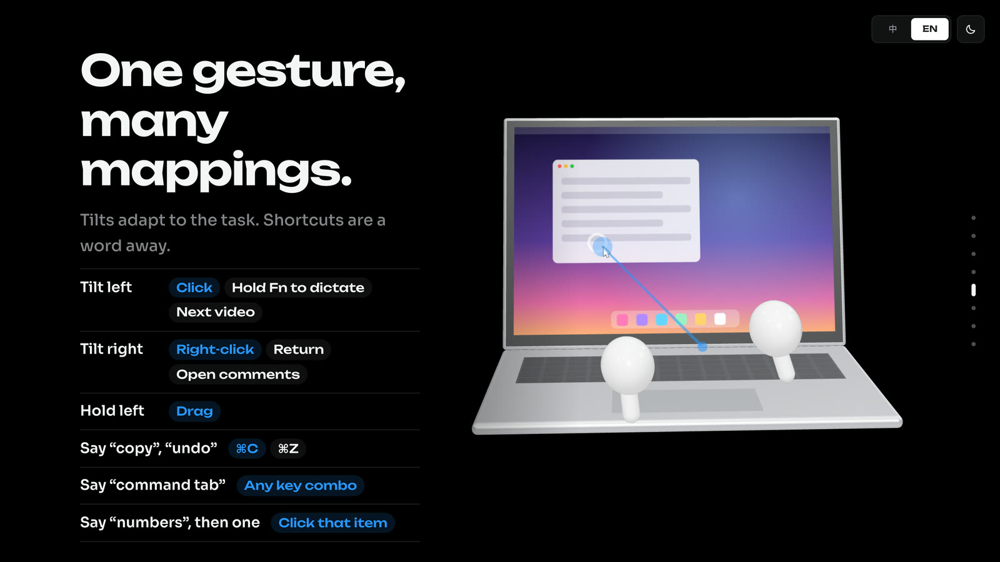<br><b>One gesture, many mappings</b> · click, dictate, next video</td>
    <td>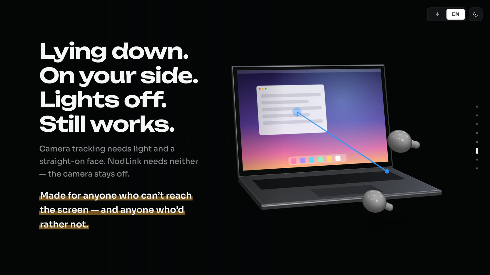<br><b>Lying down, lights off</b> · still works</td>
  </tr>
</table>

## In action

Recorded hands-free with real AirPods. The camera window (bottom right, face pixelated) shows the head movement.

<table>
  <tr>
    <td width="50%">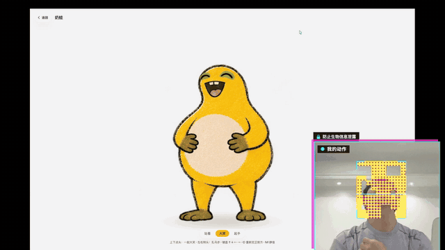<br><b>Naiwa</b> · nod and it laughs, turn and it strikes a pose</td>
    <td width="50%">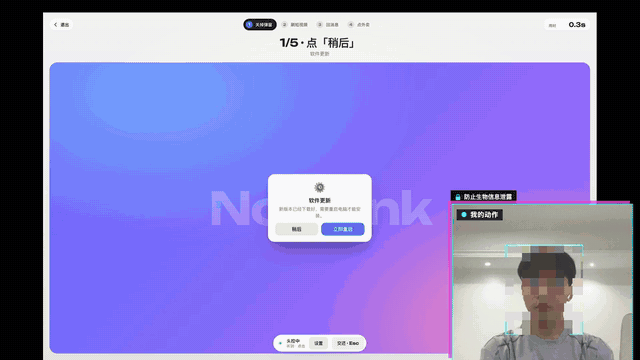<br><b>Close pop-ups</b> · point, then say “click”</td>
  </tr>
  <tr>
    <td><br><b>Short videos</b> · tilt for next, say “double click” to like</td>
    <td>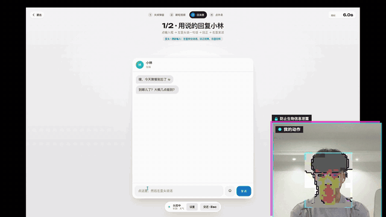<br><b>Reply</b> · tilt and hold to dictate, straighten to send</td>
  </tr>
  <tr>
    <td>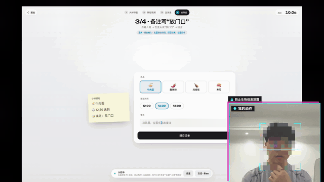<br><b>Order food</b> · pick, add a note, check out</td>
    <td>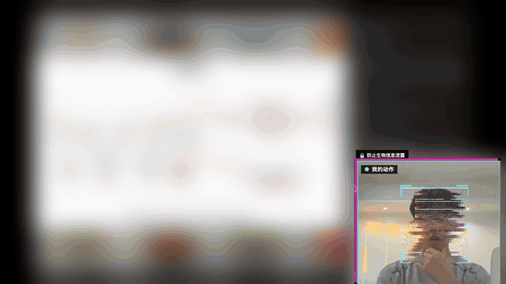<br><b>Douyin (real site)</b> · tilt for the next video (content blurred)</td>
  </tr>
</table>

## Install

You need a Mac on macOS 14 or later, AirPods with head tracking (3rd gen or later, Pro, Max), and Node.js 18+.

```bash
xcode-select --install                          # command line tools; skip if already installed
git clone https://github.com/gintmr/NodLink.git
cd NodLink/web && npm install && npm start      # console at http://localhost:8787
```

In a second terminal, start the AirPods bridge:

```bash
cd NodLink/mac/NodLinkBridge && ./run.sh
```

Put on your AirPods, open http://localhost:8787 and follow the guide at the top: connect AirPods → set straight ahead → start head control. macOS will ask for Motion & Fitness, Accessibility, Microphone and Speech Recognition access; everything stays on your Mac. Press **Esc** anytime to take the mouse back.

## How to use

| Do this | Get this |
|---|---|
| Turn your head | Move the cursor |
| Tilt left and back / tilt right and back | Click / right-click |
| Tilt left and hold | Press and drag |
| Say “click”, “double click”, “scroll down”… | Voice commands (English or Chinese) |

More: [console](web/README.md) · [AirPods bridge](mac/NodLinkBridge/README.md) (docs in Chinese)

## License

[MIT](LICENSE). Third-party 3D models are CC0, see [`web/public/models/README.md`](web/public/models/README.md). AirPods and Mac are trademarks of Apple Inc.; this project is not affiliated with Apple.
